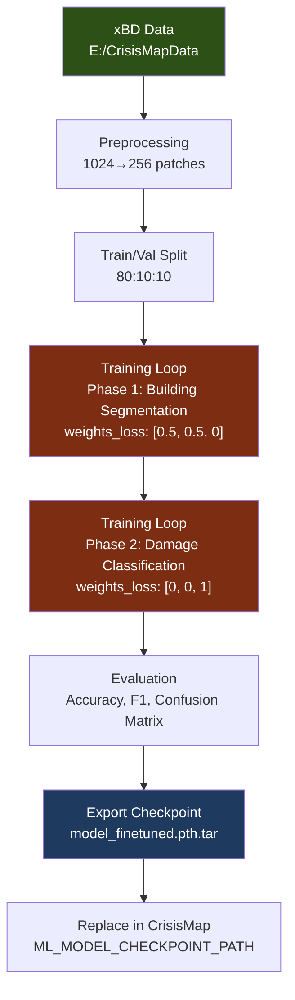
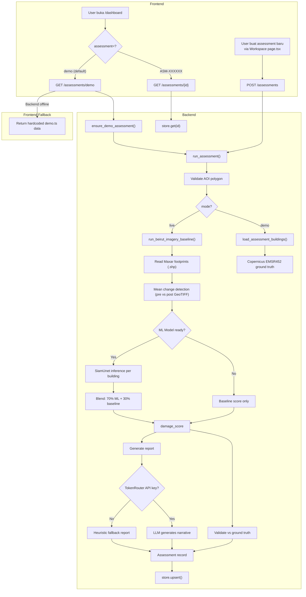

# 🔬 CrisisMap — Complete Project Analysis for Research Publication

> **Tujuan dokumen ini:** Menjawab secara detail semua pertanyaan tentang model yang digunakan, fitur yang masih hardcoded, data yang digunakan, kebutuhan training/fine-tuning, dan kesiapan riset untuk jurnal.

---

## 1. Model-Model yang Digunakan

CrisisMap menggunakan **4 "model" berbeda** secara berlapis:

### 1.1 🧠 SiamUnet (Deep Learning — Siamese CNN)

| Aspek | Detail |
|---|---|
| **Arsitektur** | Siamese U-Net (dual-arm U-Net + difference-based damage classifier) |
| **File definisi** | [end_to_end_Siam_UNet.py](file:///c:/Users/HP/Laravel/CrisisMap/data/raw/models/microsoft_building_damage_assessment_cnn_siamese/end_to_end_Siam_UNet.py) |
| **Checkpoint** | [model_best.pth.tar](file:///c:/Users/HP/Laravel/CrisisMap/data/raw/models/microsoft_building_damage_assessment_cnn_siamese/model_best.pth.tar) (~29 MB) |
| **Sumber** | Microsoft/NLRC 510 — pre-trained on xBD/xView2 dataset |
| **Input** | 2 tensor RGB 256×256 (pre-disaster chip, post-disaster chip) |
| **Output** | 3 output: (1) segmentasi bangunan pre, (2) segmentasi bangunan post, (3) damage classification logits (5 kelas) |
| **Kelas damage** | `background`, `no-damage`, `minor-damage`, `major-damage`, `destroyed` |
| **Inference code** | [ml_inference.py](file:///c:/Users/HP/Laravel/CrisisMap/backend/app/services/geospatial/ml_inference.py) |
| **Status** | ✅ Sudah bisa inference, **❌ BELUM di-train/fine-tune sendiri** |
| **Akurasi saat ini** | Accuracy: 0.778, Macro F1: 0.221 (zero-shot, domain shift dari xBD ke Beirut Maxar) |

> [!CAUTION]
> **Model ini TIDAK di-train oleh Anda.** Ini adalah checkpoint publik dari Microsoft yang diunduh dan digunakan langsung (zero-shot inference). Untuk jurnal, ini HARUS dijelaskan bahwa Anda menggunakan *pre-trained checkpoint* dan idealnya perlu fine-tuning.

### 1.2 📊 Image-Change Baseline (Deterministic, Bukan ML)

| Aspek | Detail |
|---|---|
| **Metode** | Pixel-level mean absolute difference antara pre/post imagery |
| **File** | [imagery_baseline.py L101-120](file:///c:/Users/HP/Laravel/CrisisMap/backend/app/services/geospatial/imagery_baseline.py#L101-L120) |
| **Kapan digunakan** | (a) Sebagai fallback jika SiamUnet gagal/tidak tersedia, (b) Sebagai komponen blending 30% dalam skor akhir |
| **Status** | ✅ Berfungsi — ini **bukan model ML**, melainkan rumus deterministik |

**Blending formula** (di [ml_inference.py L83](file:///c:/Users/HP/Laravel/CrisisMap/backend/app/services/geospatial/ml_inference.py#L83)):
```python
damage_score = int(round((raw_score * 0.7) + (baseline_score * 0.3)))
```

### 1.3 🤖 TokenRouter / LLM Reasoning (untuk laporan naratif)

| Aspek | Detail |
|---|---|
| **Kegunaan** | Generate laporan naratif (donor summary, phased plan, priority reasoning) |
| **API** | TokenRouter API → merutekan ke LLM (default: `anthropic/claude-sonnet-4.6`) |
| **File** | [tokenrouter.py](file:///c:/Users/HP/Laravel/CrisisMap/backend/app/services/reasoning/tokenrouter.py) |
| **Status saat ini** | ❌ **Tidak aktif** — memerlukan `TOKENROUTER_API_KEY` di `.env` |
| **Fallback** | Jika API key kosong → langsung ke heuristic fallback |

> [!IMPORTANT]
> TokenRouter ini **bukan model damage detection**. Ini hanya digunakan untuk **menghasilkan teks laporan** dari data damage yang sudah ada. Untuk jurnal, model ini tidak relevan sebagai kontribusi riset ML — yang relevan adalah SiamUnet.

### 1.4 📐 Heuristic Fallback (Deterministic Report Generator)

| Aspek | Detail |
|---|---|
| **File** | [fallback.py](file:///c:/Users/HP/Laravel/CrisisMap/backend/app/services/reasoning/fallback.py) |
| **Kegunaan** | Menghasilkan laporan prioritas dan phased plan secara deterministik berdasarkan skor damage |
| **Status** | ✅ Ini yang **selalu digunakan saat ini** karena TokenRouter API key kosong |

---

## 2. Fitur/Btn yang Masih Hardcoded

### 2.1 Frontend — Demo Layer yang Selalu Aktif

> [!WARNING]
> **Hampir SEMUA data yang ditampilkan di dashboard default adalah HARDCODED.**

| Komponen Hardcoded | File | Detail |
|---|---|---|
| **`demoAssessment`** | [demo.ts L3-26](file:///c:/Users/HP/Laravel/CrisisMap/frontend/src/lib/demo.ts#L3-L26) | Stats hardcoded: 1,420 buildings, 84 severe, 155k population |
| **`demoPriorities`** | [demo.ts L28-80](file:///c:/Users/HP/Laravel/CrisisMap/frontend/src/lib/demo.ts#L28-L80) | 3 bangunan prioritas hardcoded (St. George Hospital, Port Silo, Power Substation) |
| **`demoReport`** | [demo.ts L82-108](file:///c:/Users/HP/Laravel/CrisisMap/frontend/src/lib/demo.ts#L82-L108) | Laporan naratif lengkap hardcoded |
| **`demoGeoJson`** | [demo.ts L110-162](file:///c:/Users/HP/Laravel/CrisisMap/frontend/src/lib/demo.ts#L110-L162) | 3 polygon GeoJSON hardcoded untuk Beirut |
| **Silent fallback** | [api.ts L17-26](file:///c:/Users/HP/Laravel/CrisisMap/frontend/src/lib/api.ts#L17-L26) | `getEnvelope()` — jika backend error/offline, **diam-diam** return data demo |
| **Default assessment ID** | Dashboard defaults ke `?assessment=demo` | Backend melihat ID "demo" → bypass pipeline asli |

**Bagaimana fallback bekerja:**
```
User buka /dashboard → assessment=demo → API call ke backend
    ├─ Backend online → ensure_demo_assessment() → run_assessment() (bisa pakai ML)
    └─ Backend offline → frontend catch error → return hardcoded demo data
```

### 2.2 Backend — Hardcoded/Static Elements

| Komponen | File | Detail |
|---|---|---|
| **Default AOI** | [aoi.py](file:///c:/Users/HP/Laravel/CrisisMap/backend/app/services/geospatial/aoi.py) | `DEFAULT_BEIRUT_AOI` — polygon Beirut Port hardcoded |
| **Fixture data** | [fixtures.py](file:///c:/Users/HP/Laravel/CrisisMap/backend/app/services/fixtures.py) → `data/fixtures/beirut/assessment.json` | Data bangunan demo pre-computed |
| **Infrastructure type assignment** | [imagery_baseline.py L22-31](file:///c:/Users/HP/Laravel/CrisisMap/backend/app/services/geospatial/imagery_baseline.py#L22-L31) | Assigned berdasarkan `index % N` (bukan data nyata!) |
| **Population estimates** | [imagery_baseline.py L34-42](file:///c:/Users/HP/Laravel/CrisisMap/backend/app/services/geospatial/imagery_baseline.py#L34-L42) | Rumus heuristik, bukan data populasi sebenarnya |
| **Cost estimates** | [imagery_baseline.py L45-53](file:///c:/Users/HP/Laravel/CrisisMap/backend/app/services/geospatial/imagery_baseline.py#L45-L53) | Rumus heuristik |
| **Confidence values** | [imagery_baseline.py L261](file:///c:/Users/HP/Laravel/CrisisMap/backend/app/services/geospatial/imagery_baseline.py#L261) | Confidence di-clamp ke 0.35-0.98 secara artificial |
| **Fallback report text** | [fallback.py L50-54](file:///c:/Users/HP/Laravel/CrisisMap/backend/app/services/reasoning/fallback.py#L50-L54) | Teks laporan donor summary hardcoded |
| **Event date defaults** | [schemas.py L41-45](file:///c:/Users/HP/Laravel/CrisisMap/backend/app/models/schemas.py#L41-L45) | Default date ke Beirut explosion (2020-08-04) |

---

## 3. Data di `E:\CrisisMapData` — Apakah Digunakan?

### ✅ Ya, digunakan! Konfigurasi ada di [config.py L23-25](file:///c:/Users/HP/Laravel/CrisisMap/backend/app/config.py#L23-L25):

```python
crisismap_data_root: Path = Path("E:/CrisisMapData")
xbd_train_root: Path = Path("E:/CrisisMapData/xbd/extracted/train/train")  
xbd_tier3_root: Path = Path("E:/CrisisMapData/xbd/extracted/tier3/tier3")
```

### Data yang ada:

| Path | Isi | Ukuran |
|---|---|---|
| `E:\CrisisMapData\xbd\downloads\train_images_labels_targets.tar.gz` | xBD training data (compressed) | ~8.4 GB |
| `E:\CrisisMapData\xbd\downloads\tier3.tar.gz` | xBD tier3 data (compressed) | ~18.6 GB |
| `E:\CrisisMapData\xbd\extracted\train\train\images\` | 5,598 pre/post disaster PNG images | Extracted |
| `E:\CrisisMapData\xbd\extracted\train\train\labels\` | 5,598 JSON label files | Extracted |
| `E:\CrisisMapData\xbd\extracted\train\train\targets\` | 5,598 target mask files | Extracted |
| `E:\CrisisMapData\xbd\extracted\tier3\tier3\images\` | 12,738 images | Extracted |
| `E:\CrisisMapData\xbd\extracted\tier3\tier3\labels\` | 12,738 label files | Extracted |

### Dimana digunakan dalam kode:

1. **Status check** — [readiness.py L60-61](file:///c:/Users/HP/Laravel/CrisisMap/backend/app/services/data_sources/readiness.py#L60-L61): `validate_dataset_root()` checks apakah data xBD ada
2. **Registry** — [registry.py](file:///c:/Users/HP/Laravel/CrisisMap/backend/app/services/xbd/registry.py): `discover_tile_pairs()` membaca dan mengindeks tile pair
3. **Pipeline snapshot** — [pipeline.py L106-111](file:///c:/Users/HP/Laravel/CrisisMap/backend/app/services/pipeline.py#L106-L111): `dataset_status_snapshot()` dilaporkan dalam metadata assessment
4. **xBD Baseline Model** — [baseline.py](file:///c:/Users/HP/Laravel/CrisisMap/backend/app/services/xbd/baseline.py): `ImageChangeDamageModel` bisa process xBD tile pairs

> [!IMPORTANT]
> **Data xBD ini TIDAK digunakan untuk training model saat ini.** Data ini hanya digunakan untuk:
> - Validasi bahwa dataset tersedia (status check)
> - Evaluasi baseline image-change pada tile xBD
> - Snapshot metadata di setiap assessment
> 
> **Data ini SEHARUSNYA digunakan untuk fine-tuning model SiamUnet** — inilah gap terbesar proyek ini.

---

## 4. Apakah Perlu Train/Fine-Tune Model? **YA, WAJIB.**

### 4.1 Yang Perlu Di-Fine-Tune: **SiamUnet**

**Mengapa wajib:**
- Checkpoint saat ini: pre-trained pada xBD dataset oleh Microsoft
- Digunakan secara zero-shot pada Beirut Maxar imagery
- **Macro F1 hanya 0.221** — ini sangat rendah untuk publikasi jurnal
- Ada domain shift yang signifikan: xBD tiles 1024×1024 PNG → Beirut Maxar GeoTIFF

**Data untuk fine-tuning sudah ada di `E:\CrisisMapData`:**

| Split | Images | Labels | Targets |
|---|---|---|---|
| Train | 5,598 | 5,598 | 5,598 |
| Tier3 | 12,738 | 12,738 | — |
| **Total** | **18,336** | **18,336** | **5,598** |

### 4.2 Training Pipeline yang Perlu Dibuat

Berikut yang **belum ada** dan harus dibuat:



**Langkah detail berdasarkan README model Microsoft:**

1. **Generate masks** dari polygon labels (xBD labels → pixel masks)
2. **Generate patches** 256×256 dari 1024×1024 tiles (16 non-overlapping + 4 overlapping = 20 patches/tile)
3. **Phase 1 — Building Segmentation**: `weights_loss: [0.5, 0.5, 0]`, `mode: 'bld'`
4. **Phase 2 — Damage Classification**: `weights_loss: [0, 0, 1]`, `mode: 'dmg'` (freeze segmentation)
5. **Evaluate** pada validation set → record accuracy, F1, confusion matrix, loss curves
6. **Export** checkpoint baru

> [!TIP]
> Training notebook bisa dibuat di Google Colab/Kaggle dengan GPU gratis (T4/P100). Data xBD total ~27 GB — upload ke Google Drive atau Kaggle Dataset.

---

## 5. Flow Aplikasi — Apakah Benar-Benar Berfungsi?

### 5.1 Flow Diagram Lengkap



### 5.2 Status Fungsionalitas per Fitur

| Fitur | Status | Catatan |
|---|---|---|
| 🗺️ Map rendering + GeoJSON overlay | ✅ Berfungsi | Leaflet + damage polygons |
| 🔀 Split view (pre/post imagery) | ✅ Berfungsi | Jika Maxar GeoTIFF tersedia |
| 📊 Dashboard statistics | ⚠️ Demo data | Default menampilkan data hardcoded |
| 🏗️ New assessment (live mode) | ✅ Berfungsi | Memerlukan Maxar imagery + footprints |
| 🧠 SiamUnet ML inference | ✅ Berfungsi | Tapi akurasi rendah (F1: 0.221) |
| 📝 Report generation | ⚠️ Fallback only | TokenRouter API key tidak ada → heuristic |
| 📥 Export PDF/DOCX/GeoJSON | ✅ Berfungsi | Dynamic berdasarkan data assessment |
| 🏥 Priority infrastructure list | ⚠️ Campuran | Live assessment → dynamic; default → hardcoded |
| ⚙️ Settings page | ✅ Berfungsi | Bisa ubah model profile, thresholds |
| 📜 History page | ✅ Berfungsi | Menampilkan assessments yang tersimpan |
| 🗄️ PostGIS persistence | ⚠️ Optional | Fallback ke JSON file jika DB tidak tersedia |
| 🛰️ Imagery tile server | ✅ Berfungsi | Serve pre/post Maxar tiles via backend |

### 5.3 Bug/Masalah Logic yang Ditemukan

1. **Infrastructure type assignment yang salah** — Di [imagery_baseline.py L22-31](file:///c:/Users/HP/Laravel/CrisisMap/backend/app/services/geospatial/imagery_baseline.py#L22-L31), tipe infrastruktur ditentukan berdasarkan `index % N`:
   ```python
   if index % 41 == 0: return "Medical Facility"
   if index % 23 == 0: return "Utility Infrastructure"
   ```
   Ini **bukan klasifikasi nyata** — hanya distribusi pseudo-random.

2. **Confidence di-clamp artificial** — Confidence tidak benar-benar merepresentasikan model uncertainty, tapi di-bound antara 0.35-0.98.

3. **Population & cost estimates** — Menggunakan rumus heuristik, bukan data aktual (WorldPop data ada tapi tidak diintegrasikan dalam pipeline ini).

---

## 6. Kesiapan untuk Jurnal — Gap Analysis

### 6.1 Pertanyaan Jurnal yang BISA Dijawab Saat Ini

| Pertanyaan | Jawaban |
|---|---|
| Model apa yang digunakan? | SiamUnet (Siamese U-Net) dari Microsoft/NLRC 510 |
| Dataset apa? | xBD/xView2 (pre-trained), Beirut Maxar + Copernicus EMSR452 (inference & validation) |
| Arsitektur? | Dual-arm U-Net dengan difference-based damage classifier, 5 output classes |
| Input model? | 2 RGB image 256×256 (pre & post disaster) |
| Output model? | Building segmentation + damage classification (4 level + background) |
| Digunakan dimana? | Inference per-building dari Maxar GeoTIFF, output ke GeoJSON + priority ranking |

### 6.2 Pertanyaan Jurnal yang BELUM BISA Dijawab ❌

| Pertanyaan | Status | Yang Dibutuhkan |
|---|---|---|
| Bagaimana cara train model? | ❌ Belum ada training script | Buat training notebook |
| Berapa accuracy setelah fine-tune? | ❌ Belum fine-tune | Fine-tune pada xBD → eval |
| Training loss curve? | ❌ Tidak ada | Record selama training |
| Val/Test split? | ❌ Tidak dijalankan | Implementasi split 80:10:10 |
| Hyperparameters? | ❌ Tidak ada | Dokumentasikan lr, batch_size, epochs, optimizer |
| Perbandingan baseline? | ❌ Hanya 1 model | Bandingkan dengan ResNet/VGG baseline |
| Fine-tuning vs zero-shot improvement? | ❌ Tidak ada | Ukur sebelum & sesudah fine-tune |
| Computational cost? | ⚠️ Hanya inference time (~51s/60 buildings CPU) | Training time juga perlu dicatat |

### 6.3 Metrik yang Ada vs yang Dibutuhkan

**Saat ini tersedia (zero-shot):**
```
Accuracy: 0.778
Macro F1: 0.221
Per-class F1: sangat rendah (karena domain shift)
Confusion matrix: tersedia
```

**Yang dibutuhkan untuk jurnal:**
```
□ Training accuracy & loss per epoch (train + val)
□ Test set accuracy, precision, recall, F1 (macro + per-class)
□ Confusion matrix pada test set setelah fine-tuning
□ Comparison table: zero-shot vs fine-tuned
□ Optional: ROC curve, PR curve
□ Inference time per image
□ GPU/CPU resource usage
```

---

## 7. Rekomendasi Aksi untuk Kesiapan Jurnal

### Prioritas 1: Fine-Tune SiamUnet (WAJIB)

1. Buat training script/notebook (Colab/Kaggle recommended)
2. Preprocess xBD data: generate masks + 256×256 patches
3. Split: train 80%, val 10%, test 10%
4. Phase 1: Train building segmentation (`weights_loss: [0.5, 0.5, 0]`)
5. Phase 2: Train damage classification (`weights_loss: [0, 0, 1]`)
6. Record semua metrics: loss curves, accuracy, F1, confusion matrix
7. Export checkpoint baru
8. Test pada Beirut imagery → bandingkan dengan zero-shot

### Prioritas 2: Dokumentasi Riset

- Metodologi yang jelas: preprocessing → training → inference → validation
- Tabel perbandingan: zero-shot vs fine-tuned
- Analisis kesalahan (error analysis) pada confusion matrix
- Limitasi dan future work

### Prioritas 3: Perbaiki Hardcoded Elements

- Ganti infrastructure type assignment berbasis modulo → gunakan data OSM/HDX
- Integrasikan WorldPop data untuk population estimates
- Hapus atau jelaskan demo fallback layer

---

## 8. Ringkasan Akhir

```
┌────────────────────────────────────────────────────────┐
│                  STATUS PROYEK                          │
├─────────────────────┬──────────────────────────────────┤
│ UI/UX               │ ✅ 100% selesai & polished       │
│ Backend API         │ ✅ Berfungsi penuh               │
│ ML Inference        │ ⚠️ Berfungsi tapi zero-shot      │
│ ML Training         │ ❌ BELUM ADA                     │
│ Data xBD            │ ✅ Sudah didownload & extracted   │
│ Model Fine-tuning   │ ❌ BELUM DILAKUKAN               │
│ Accuracy/F1         │ ⚠️ Rendah (F1: 0.221)            │
│ Demo/Hardcoded      │ ⚠️ Banyak (frontend + backend)   │
│ Jurnal-ready        │ ❌ BELUM — perlu training + eval  │
└─────────────────────┴──────────────────────────────────┘
```

**Bottom line:** Proyek ini memiliki arsitektur yang solid dan UI yang polished, tapi **belum siap untuk jurnal** karena:
1. Model SiamUnet belum di-fine-tune — masih pakai checkpoint Microsoft apa adanya
2. Tidak ada training script, loss curve, atau hyperparameter documentation
3. Akurasi saat ini terlalu rendah untuk dipublikasikan (F1: 0.221)
4. Banyak data yang hardcoded dan bisa membuat reviewer mempertanyakan validitas sistem

**Langkah terpenting:** Buat training pipeline → fine-tune SiamUnet pada xBD data → evaluasi pada Beirut → dokumentasikan semua metrics.
